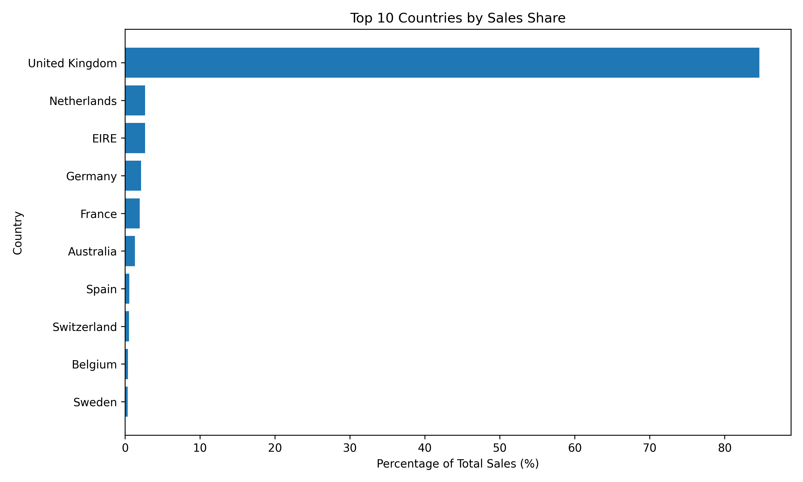
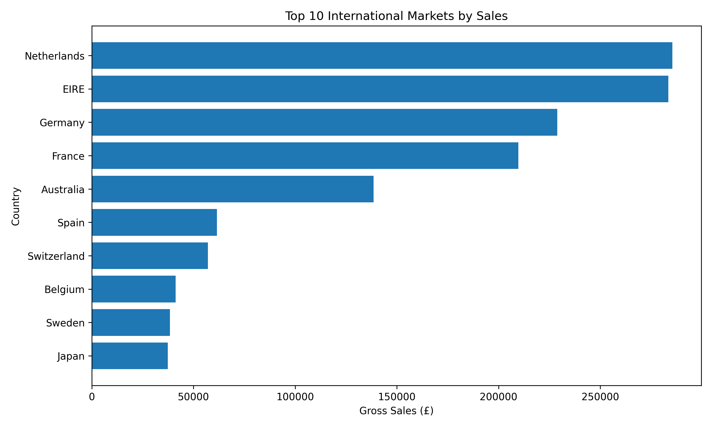
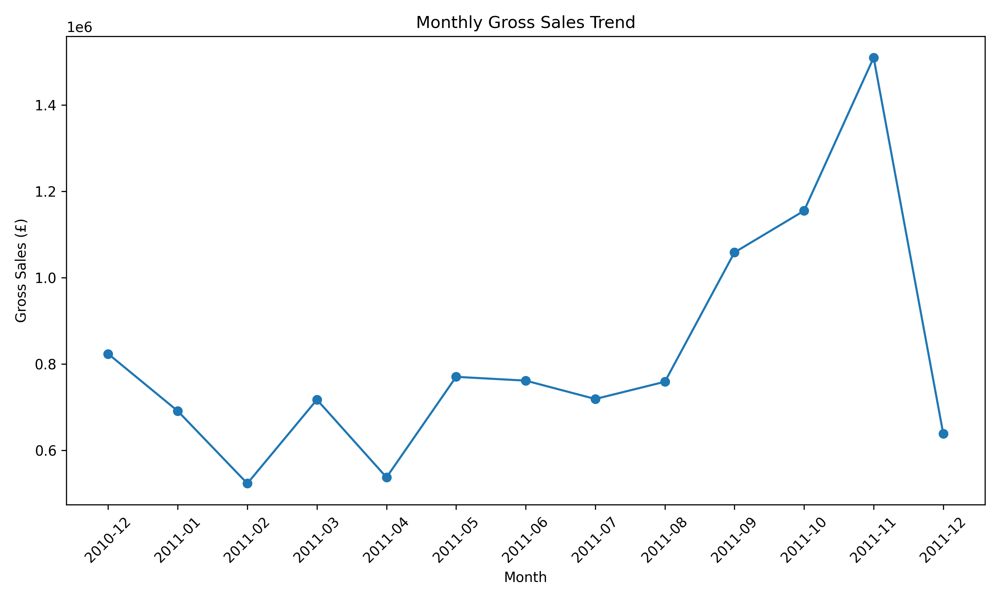
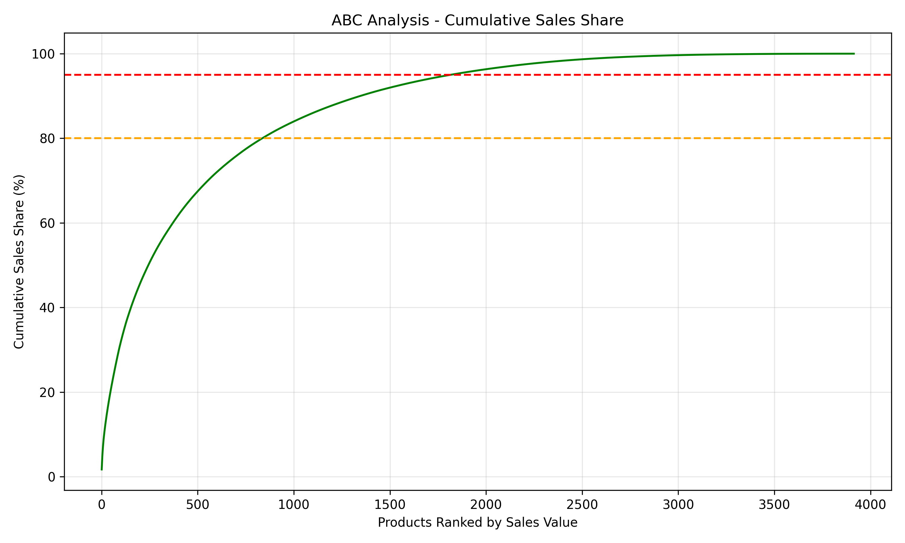

# Retail Sales Analysis

This project uses Python to analyze the UCI Online Retail dataset. It examines gross sales by country and month and uses ABC analysis to classify products by their contribution to gross sales.

The analysis answers three questions:

- Which countries account for the largest share of gross sales?
- How did gross sales change from month to month?
- How many products change ABC class when exact duplicate rows are removed?## Key Findings

- **Gross sales totaled £10,666,684.54** across 530,104 invoice lines after excluding cancellations and rows with non-positive quantities or unit prices.
- **The United Kingdom accounted for 84.61% of gross sales**, contributing £9,025,222.08.
- **Removing exact duplicate rows reduced gross sales by £24,573.74 (0.23%).** In the ABC analysis, 11 of 3,908 products (0.28%) changed class. Two moved from A to B, and two moved from B to A. 
## Methodology

1. **Filter invoice lines.** The source workbook contains 541,909 invoice lines. I excluded cancellations (invoice numbers starting with `C`) and lines with a quantity or unit price of zero or less. This left 530,104 lines for the baseline sales analysis.
2. **Calculate gross sales.** I multiplied `Quantity` by `UnitPrice` for each retained line, then summed the results by country and month.
3. **Classify products.** For the ABC analysis, I excluded service codes and selected exceptional stock codes. I grouped the remaining sales by `StockCode`, ranked products by gross sales, and classified them using their cumulative share of product sales. Class A covers up to 80%, class B covers shares above 80% through 95%, and class C covers shares above 95%.
4. **Check the impact of exact duplicates.** I identified rows that matched across all original columns. I kept them in the baseline and compared it with a scenario that retained only the first occurrence of each identical row. I measured the effect on gross sales and ABC classifications.## Visualizations

### Gross Sales by Country



### International Sales Excluding the United Kingdom



### Monthly Gross Sales Trend



### ABC Analysis and Pareto Curve

## How to Run

1. Download `Online Retail.xlsx` from the [UCI Online Retail dataset page](https://archive.ics.uci.edu/dataset/352/online+retail) and place it in the project folder.
2. Open a terminal in the project folder and install the Python dependencies:

   ```bash
   python3 -m pip install pandas openpyxl matplotlib
   ```

3. Filter the invoice lines and generate the sales analysis:

   ```bash
   python3 analysis.py
   python3 sales_analysis.py
   ```

   `analysis.py` creates `sales_filtered.csv`, which `sales_analysis.py` uses to generate the charts.

4. Reproduce the duplicate-row checks and the ABC comparison:

   ```bash
   python3 duplicate_audit.py "Online Retail.xlsx"
   python3 abc_compare.py
   ```

   `duplicate_audit.py` reports how removing exact duplicate rows affects gross sales. `abc_compare.py` creates `abc_class_changes.csv`, which lists the products that changed class.